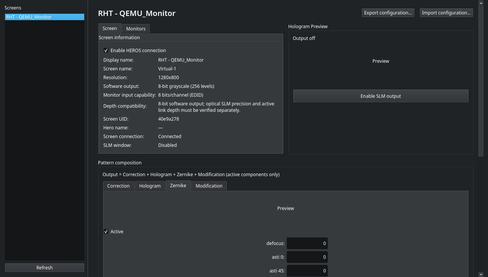
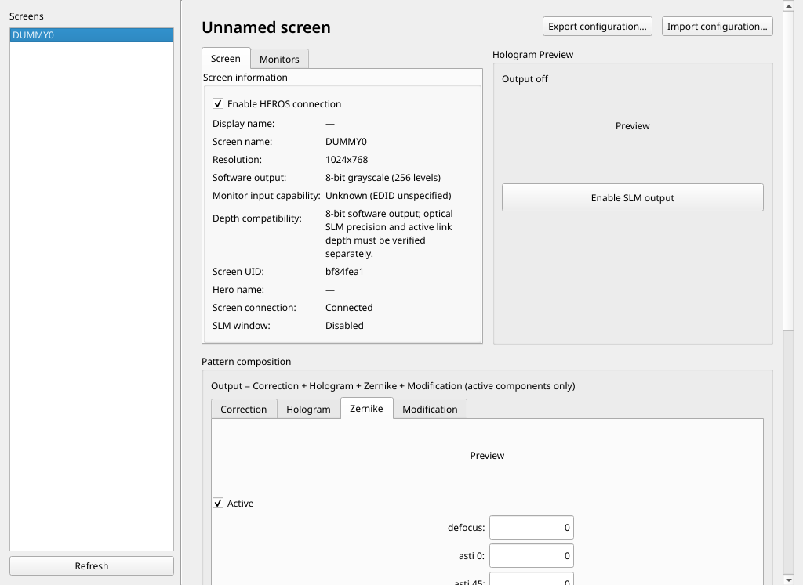
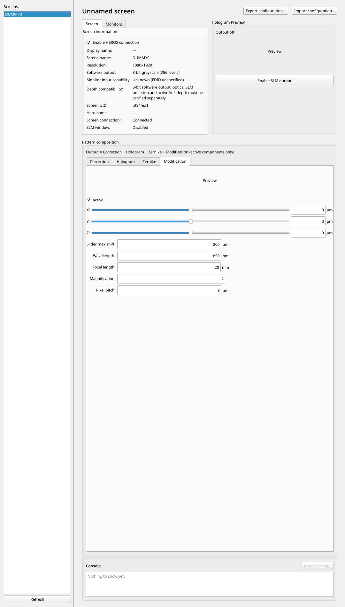
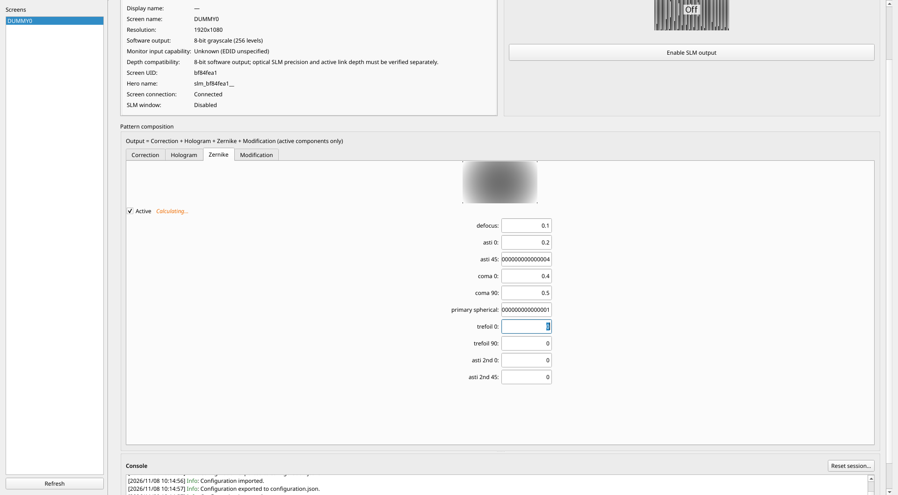
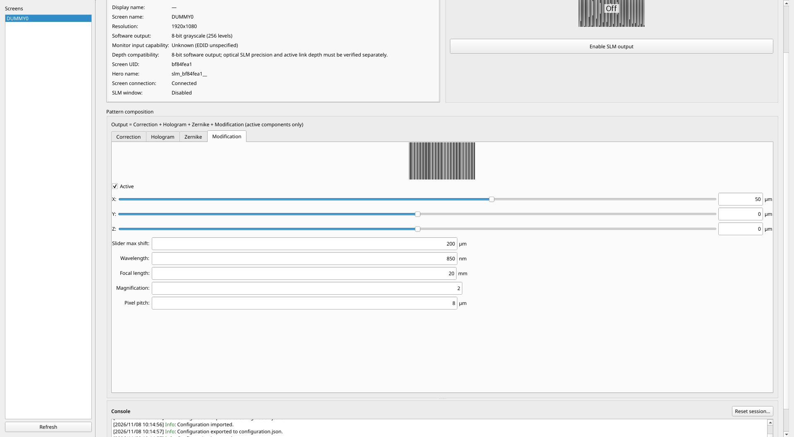

# Fork implementation review and integration validation

This is the current fork result, separate from the historical upstream [review](REVIEW.md). Each F01–F16 work item has an individual commit with implementation, review and actual test evidence in [CHANGELOG-FORK.md](../../CHANGELOG-FORK.md). F17 records this integration pass. The work is on branch `fork/improvements`.

## Current outcomes

- **38 unit/regression tests pass**, including deterministic coalescing, cached-value reversal, reset invalidation, live slider text, readable small-window fields, configuration versions/connection lifetime, monitor identity, resized native buffers, reversible flips, depth parsing and preview isolation.
- **Ruff passes** for the repository and standalone client.
- Server and standalone client **wheels and source distributions build successfully**. The standalone client's import regression confirms it does not import Qt or server code and exits without a persistent discovery connection.
- **123/123 integration expectations pass** across seven isolated-display scenarios. An additional native KDE run passes both discovery/layout expectations and saves dark-theme screenshots.
- No scenario reports an unhandled exception. Baseline screenshots/results remain intact in `results/`.

| Scenario | Expectations passed | Result |
|---|---:|---|
| 1024x768 | 19/19 | Readable scrolling UI; imports, flips, output geometry, configuration, Zernike and modification pass. |
| 1280x800 | 19/19 | Window fits; numeric fields retain usable height. |
| 1080x1920 portrait | 19/19 | Control window fits and portrait native output passes. |
| 3440x1440 ultrawide | 13/13 | Native buffers/output, file patterns, flips, configuration export and lifecycle pass. |
| 3840x2160 4K | 13/13 | Same functional path with a true 3840x2160 output pixmap. |
| Three simultaneous outputs | 8/8 | Distinct identities/sessions, native output on all three, secondary-only removal and restoration. |
| Full HD + five-second work + hotplug | 32/32 | Both coalescing paths, A-B-A correctness, live slider text, HEROS config migration, geometry resize and monitor add/remove pass. |

The integration harness uses real `QScreen` objects, the production Linux adapter, real session/window objects, actual NPY/BMP fixtures and Qt keyboard/mouse events. Only file-dialog paths and five-second calculation delays are instrumented. Pattern tabs are explicitly selected before interaction; hidden controls are not treated as a substitute for reachable UI.

## Five-second calculation review

With each actual calculation delayed by five seconds:

- Six Zernike edits take about **0.38 seconds** to enter, with **two** calculations (first + newest), no obsolete FIFO queue, and the final state after about **10.1 seconds**.
- Six modification edits likewise take about **0.38 seconds**, with **two** calculations and the newest output after about **10.1 seconds**.
- Returning to defocus 0.1 while 0.9 is in flight leaves the final applied value at **0.1**.
- The upstream baseline took about 15.1 seconds and six jobs for the same six-edit workload. The new design intentionally allows an already running job to finish, then computes the newest snapshot; it does not claim thread cancellation interrupts numerical work.

Exact measurements and checks: [full-HD JSON](fork-results/full-hd-slow-hotplug.json), [runtime log](fork-results/full-hd-slow-hotplug.log).

## UI evidence

### Native KDE dark theme

Inputs keep their height; scrolling provides access to every field instead of shrinking them. Metadata and pattern tabs reduce competing columns. Output state is separate from the enable/disable action; software/EDID bit depths are clearly labeled.

### Small window and portrait

### Calculations, inactive previews and native output

Inactive overlays affect bounded previews only. Native frame arrays and configuration patterns retain their original data.

## Performance review

The bounded 4K GUI preview benchmark copies **57,600 bytes** per pattern instead of **33,177,600 bytes**. On this VM, ten-iteration averages were about **0.053 ms** for bounded sampling versus **0.87 ms** for a full-array copy. This is a copy/sampling microbenchmark, not a claim about total frame rate or optical refresh timing. See [benchmark JSON](fork-results/F12-preview-benchmark.json).

Notebook previews default to approximately one million pixels, preserve native coordinate extents and support `max_preview_pixels=None` for full sampling. The public full-resolution snapshot API remains unchanged.

## Review limitations and remaining environment checks

- Windows Aero Peek is implemented against DWM with pointer-sized HWND and four-byte BOOL arguments. Success/failure contracts are tested on Linux; **visual verification on Windows remains pending**.
- EDID depth tests use valid/corrupt digital/analog/legacy fixtures. Real optical phase precision, active transport depth and >8-bit hardware are **not verified**. Higher-depth optical output remains outside scope.
- Integer geometry/DPI dimension changes invalidate jobs and reset pixel-dependent state. Fractional/aggressive scaling requires real compositor/hardware tests; the 1.0-DPR lab does not establish those cases.
- Large-resolution Zernike grids/configuration import are intentionally not run in ultrawide/4K scenarios; full-HD and smaller cases exercise those paths.
- The new REST API and >8-bit optical output remain the agreed future ideas, not partially implemented promises.

Run [run_matrix.sh](run_matrix.sh) after starting the isolated display described in [README.md](README.md). The runner preserves baseline evidence and now fails on any failed expectation or scenario exception.

## Disconnect identity follow-up

Review after the full matrix identified that physical EDID can disappear before a removal callback. F06a uses the already observed QScreen-to-UID mapping instead of reading a new identity during unplug. A regression verifies that the original record/session is detached without querying unavailable EDID. The existing no-EDID matrix is unaffected; the final regression suite has 38 tests.
