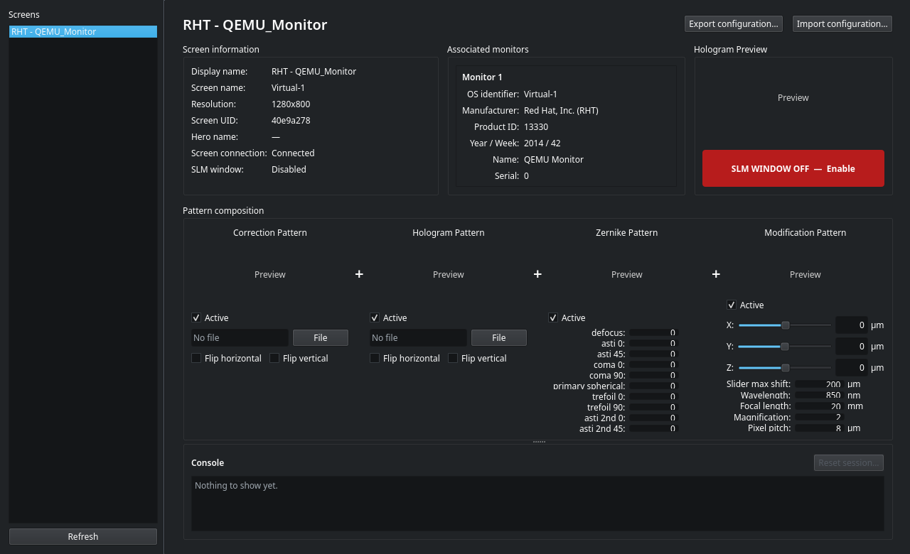
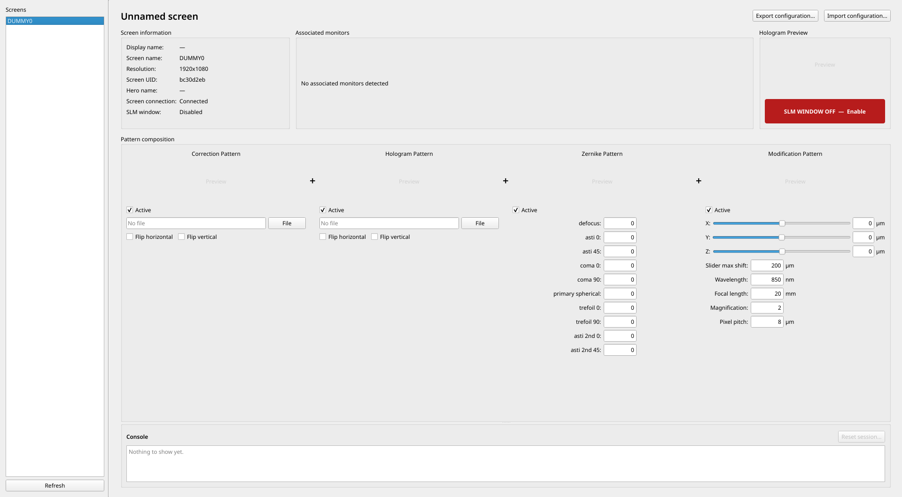
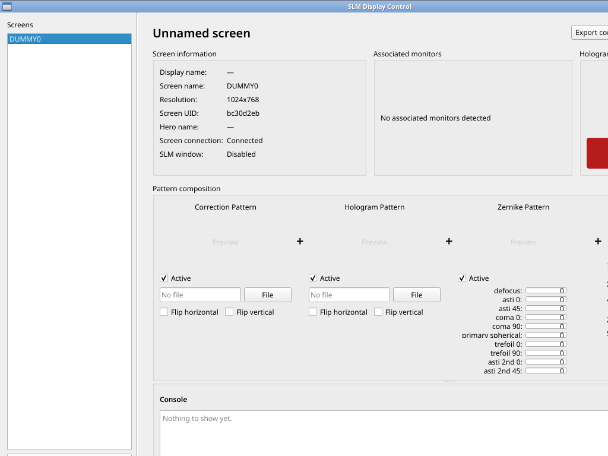
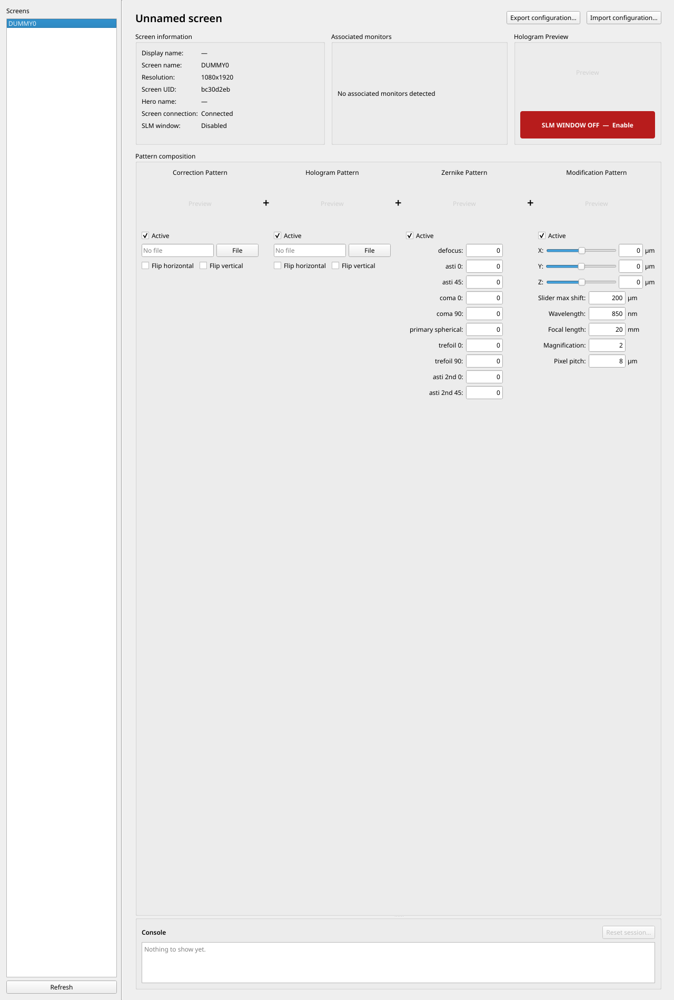
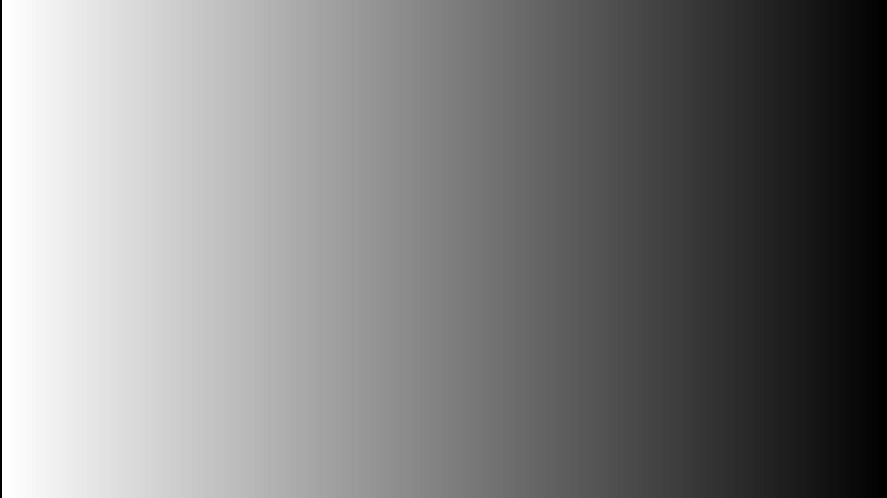
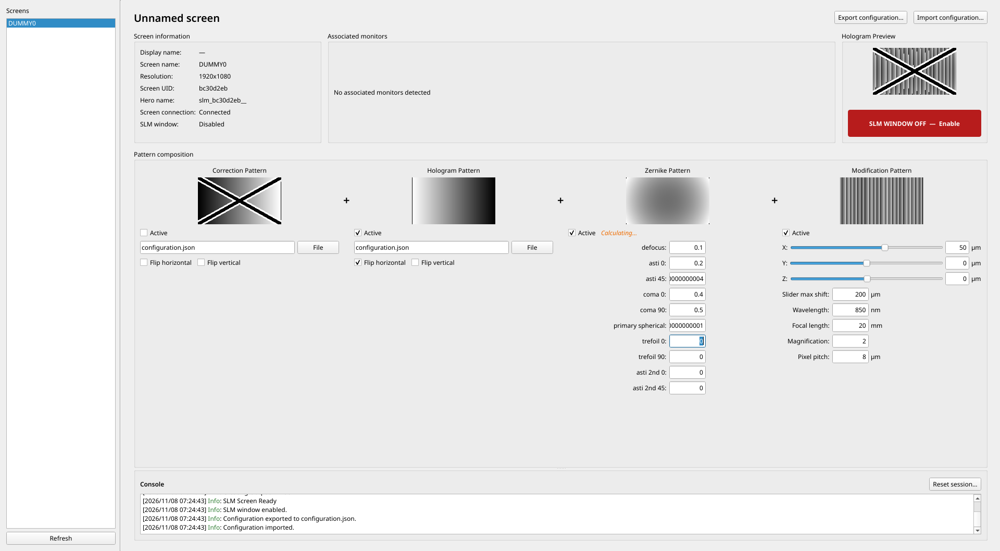

# Moretz SLM Control review and virtual-monitor verification

Reviewed 2026-11-08, upstream commit `81b5f2b` (`master`), version `0.3.4.post2`.
Fork: https://github.com/MoretzAccAi/MoretzSlmControl

The desktop application has a useful foundation: explicit per-screen sessions, separation between UI/monitor/platform layers, a standalone client, revisioned frame delivery, configuration import/export, and deterministic pattern helpers. It runs on this Debian 13 KDE VM without production code changes. The main weaknesses are display identity/lifecycle correctness and the way fixed layout constraints interact with small windows. Background pattern computation exists, but its scheduling needs coalescing and stronger invalidation.

This change set is a review and reproducible testing lab. Production source files have not been modified, and the issues below remain open. The fork was created on GitHub; this review and its artifacts are stored in the local checkout under `dev/review/`.

## Screenshots and UI assessment

### Native KDE dark theme, 1280 x 800

The four-term composition explains how correction, hologram, Zernike and modification contribute to the output. Screen metadata and an explicit output-window button are useful. However, the upper information area consumes substantial height, the two file-pattern panels leave most of their lower area empty, and ten Zernike rows are squeezed into very short fields. The number fields do not grow even when other panels have free space. The output button's saturated red reads as an error/alarm rather than a normal disabled state.

### Full HD, 1920 x 1080

Full HD gives the controls usable heights, but Zernike fields remain limited to 70 pixels and shift fields to 46 pixels. The side-by-side layout still allocates large empty regions to file components. Preview height is fixed at 90 pixels. The lab uses default Qt light styling: the hard-coded `#d0d0d0` preview placeholder has poor contrast on this background.

### 1024 x 768 and portrait

The hard minimum of 1280 x 780 exceeds a 1024 x 768 display and the 1080-pixel width of the portrait display. On 1280 x 800, even the minimum client height plus window decoration slightly exceeds the available height in the Xorg/Openbox lab. These are actual geometry failures, not just a preference for larger fonts. Whole-widget screenshots can extend beyond the monitor; desktop captures show the visible clipping.

### Native SLM output and active computations

The output window and its pixmap match the target pixel geometry in every single-monitor case. The ramp is deliberately synthetic; these tests do not establish optical phase response, panel bit depth or hardware refresh behavior.

## Prioritized improvements

| Priority | Finding | Evidence and impact | Proposed change |
|---|---|---|---|
| P0 | Distinct screens collide when EDID is absent | Qt reports DUMMY0/DUMMY1/DUMMY2 at different offsets and resolutions; the application creates one record with UID `bc30d2eb`, overwritten with DUMMY2's metadata. Removing a secondary screen can mark the remaining screen disconnected. | Include a stable connector/screen-name fallback in the UID when EDID is missing; detect collisions rather than overwrite. Clearly distinguish fallback identity from reliable EDID identity. |
| P0 | Returning to the last applied parameters can install a stale result | Apply defocus 0.1; request 0.9 with a delayed calculation; request 0.1 again before completion. UI says 0.1, output state becomes 0.9. | Every accepted desired-state change must invalidate older work, including a return to the last applied value. Track desired state separately from applied state. |
| P1 | Zernike and modification requests accumulate | Six edits in about 0.19 s create six 5-second jobs on two workers, with four queued; final state takes about 15.1 s for either component. | Keep one running request and one replaceable desired snapshot per session/component. A dirty flag launches only the newest snapshot after completion. Discard stale results before applying them. |
| P1 | Mode changes keep old pattern buffers | After 1920x1080 -> 1280x800, the record updates to 1280x800 but the session stays at shape (1080,1920). | Handle geometry/DPR changes explicitly: invalidate calculations, resize or recreate buffers/grid/session, and define how imported patterns are retained or rejected. Never silently stretch old pixel data. |
| P1 | Fixed layout makes numeric inputs tiny or clips the whole UI | Native KDE 1280x800 and small/portrait screenshots above. Minimum 1280x780, fixed previews, 46/70-pixel maximum input widths. | Use responsive sections/tabs or a wrapping grid; add a scroll area and a horizontal splitter; provide readable minimum field heights based on font metrics and expanding numeric widths. Collapse metadata; persist panel sizes. |
| P1 | Shift text does not track dragging | Slider position is 50 while its numeric field remains 0; release updates it. | Connect `valueChanged`/`sliderMoved` to the inexpensive text update. Keep expensive calculation independently debounced/coalesced. Cover mouse drag, wheel and keyboard input. |
| P1 | SLM output steals focus | Enabling output switches `QApplication.activeWindow()` to the output. `attach_window_to_screen` and each visible frame refresh explicitly raise/activate it. | Position/show the output without activating it and stop activating on every frame. Preserve intended control-window focus, while verifying compositor-specific fullscreen behavior. |
| P2 | Main window still owns expensive completion work | Applying computed patterns calls composition/frame publication on the GUI thread; previews obtain full-resolution copies. This is a code-review concern, not measured as a five-second real-compute stall here. | Move pure array composition/conversion to a bounded worker; dispatch only the current frame/preview to Qt. Measure real frame times and lock contention before optimizing. |
| P2 | Limited computation status/error feedback | `Calculating…` exists, but does not distinguish queued/latest/applied state; invalid input is primarily reported in the console. | Show applied vs pending state, inline validation, and accessible status text. Keep fields editable while work runs. |
| P2 | Visual hierarchy and language | Bright enable/disable control, large empty panels, low-contrast light-theme placeholders, unexplained Zernike abbreviations and abbreviated units. | Use theme palette colors, a compact state+action control, consistent spacing, tooltips with physical definitions/units, and explicit Off/Disabled overlays. |
| P2 | Missing GUI/lifecycle coverage in the standard test suite | All 15 unit tests and Ruff pass despite the reproduced GUI defects. | Add targeted regression tests for UID collision, cached-value reversal, bounded work queues, resolution/hotplug behavior and live slider text; keep this lab for integration verification. |

### Coalescing design for the requested five-second case

Maintain `desired_parameters`, `desired_revision`, `running`, and `dirty` for each `(screen_uid, component)`. On a valid edit, update desired parameters and revision immediately. If running, replace the pending snapshot and mark dirty; do not enqueue another job. Completion applies only a result matching the current desired revision and screen-generation token. If dirty, schedule exactly one calculation using the newest parameters. Clearing a dirty state must not lose an edit that arrives during completion.

Keep the previously applied frame visible while new work runs. In particular, returning from A -> B -> A must invalidate B even when A matches the cached applied value. Reset/disconnect/resolution changes must invalidate the generation so late callbacks cannot restore obsolete state. Use independent desired states per component and screen, but keep a bounded global executor for CPU and memory control. Do not read widgets from worker threads.

### Responsive-layout acceptance criteria

- All controls remain reachable at 1024x768, 1280x800, portrait 1080x1920, full HD, ultrawide and 4K; scrolling is acceptable, inaccessible controls are not.
- Numeric fields keep a usable font-relative minimum height and enough width for signs, decimals and scientific notation; resizing does not compress them into slits.
- Pattern panels wrap, collapse or become tabs when width is limited. The output/control geometry and optical pixel dimensions remain independent of UI scaling.
- Slider text changes immediately while dragging even when its calculation takes five seconds. Calculations remain bounded and eventually represent the newest desired state.

## Existing DEV_NOTES.md: disposition

All existing entries were read; none are silently considered fixed by this review.

| Existing note | Review disposition |
|---|---|
| SLM window gains focus | Reproduced and promoted to P1. Repeated frame activation is visible in platform code. |
| Windows Aero Peek / anti_aero_peak.py | Preserve as Windows-specific work; not verified in this Linux VM. |
| Enable/disable button redesign | Confirmed UI issue; use state plus action instead of alarm-red as the normal off state. |
| Make HEROS toggleable | Useful: session creation currently registers a HERO even before the output is enabled. Expose an explicit connection state/control and keep client compatibility. |
| Remove duplicate client/server helpers | A focused maintenance task; keep the client independent of Qt, monitor and server packages. Add shared-contract checks before extraction. |
| Make plotHologram faster | Still worth profiling; no dedicated plotting benchmark was performed. Target preview copies, grid reuse and render timing rather than assuming it is the main bottleneck. |
| Refactor `_set_pattern_flip` | Maintenance improvement; preserve tested flip/inclusion/export semantics. |
| Show bit depth / warn above 8-bit | Important product transparency. Internal output is uint8; dummy framebuffer depth 24 does not prove an optical SLM's phase bit depth. Show known capability or Unknown, and warn on positively detected unsupported capabilities. |
| Replace crossed-out preview with Off/Disabled | Improve state clarity and theme contrast; do not change the underlying pattern's numerical values to draw UI overlays. |
| Support more than 8-bit / optional REST | Future features, separate from current correctness fixes and existing API compatibility. |
| Recheck README refresh limitation | Partially outdated: record dimensions refresh in the tested Xorg mode switch. Existing buffers do not resize, so the underlying limitation remains and needs more precise wording. |
| Add examples, identity rules, screen/monitor relationship to README | Add a minimal roundtrip example and explain identity fallback/reconnection. README's assertion that duplicate UIDs are impossible is contradicted by the no-EDID test. |
| Fractional/aggressive scaling as won't-fix | Not tested here. Define supported scaling behavior and make unsupported cases explicit instead of implying the matrix proves these cases. |

## Functional test matrix

Single-monitor cases use the real Linux adapter without a UID or EDID shim. The triple-output case deliberately retains the collision to expose the defect.

| Scenario | What was exercised | Result |
|---|---|---|
| 1024x768 | File imports, byte output, flip/toggle, output on/off, config roundtrip, real Zernike/shift calculation, reset | Core checks pass; control window clipped, focus steal and delayed slider text reproduced. |
| 1280x800 | Same functional path | Core checks pass; fields compressed and height exceeds available area with decorations. |
| 1080x1920 portrait | Same functional path | Native portrait buffers/output pass; control width still 1280, causing clipping. |
| 1920x1080 | Same functional path plus two five-second workloads, cached-value reversal and hotplug/mode switch | 22/30 expectations pass. Failures correspond to the defects above; no unhandled exception. |
| 3440x1440 ultrawide | File imports, byte output, flip/toggle, output on/off, config export, reset | 12/13 expectations pass; focus steal fails. Zernike calculation/config import not run at this size. |
| 3840x2160 4K | Same as ultrawide, native 3840x2160 pixmap/output | 12/13 expectations pass; focus steal fails. Large Zernike grids were not exercised. |
| Three outputs: full HD + portrait + 4K | Native Qt enumeration, application record identity, control UI | Qt sees 3; app exposes 1. Independent simultaneous sessions are blocked by this defect. |
| KDE native VM display, 1280x800 | Actual dark-theme UI and QEMU EDID metadata | Correct EDID identity; cramped layout confirmed. Only discovery/layout captured in this extra run. |

The exact per-check values are in the scenario JSON files. Counts include expectations intended to reveal defects; they are not a claim of a green test suite. No scenario has an `exception` entry. Float32 phase wrapping checks allow one circular gray level of numerical rounding. The original strict equality check at 1024x768 exposed one-level rounding differences; the final harness uses the documented tolerance and that scenario was rerun.

Additional verification:

- Standard suite: **15 tests passed**, [log](results/unittest.log).
- Existing Ruff check: **passed**, [log](results/ruff.log).
- Full-HD detailed runtime evidence: [JSON](results/full-hd-slow-hotplug.json), [log](results/full-hd-slow-hotplug.log).
- Multi-monitor collision evidence: [JSON](results/three-monitors.json).
- Reproduction commands and limits: [lab README](README.md), [matrix runner](run_matrix.sh), [UI harness](exercise_ui.py), [Xorg config](xorg-dummy.conf).

## Recommended implementation order

1. Fix no-EDID identity and collision handling; add a regression that starts three distinct sessions and removes/readds one screen.
2. Replace unbounded per-edit submission with latest-desired-state coalescing for both components, including cached-value reversal and reset generation checks.
3. Update slider text independently of calculations; test with the five-second harness.
4. Rework UI sizing/scrolling and metadata density using the screenshots as acceptance examples.
5. Define mode/DPR-change session behavior, remove focus stealing, and verify all geometry cases again.
6. Address DEV_NOTES items by priority, then profile full-resolution calculation/composition/preview work and add hardware/Windows/scaling coverage.
