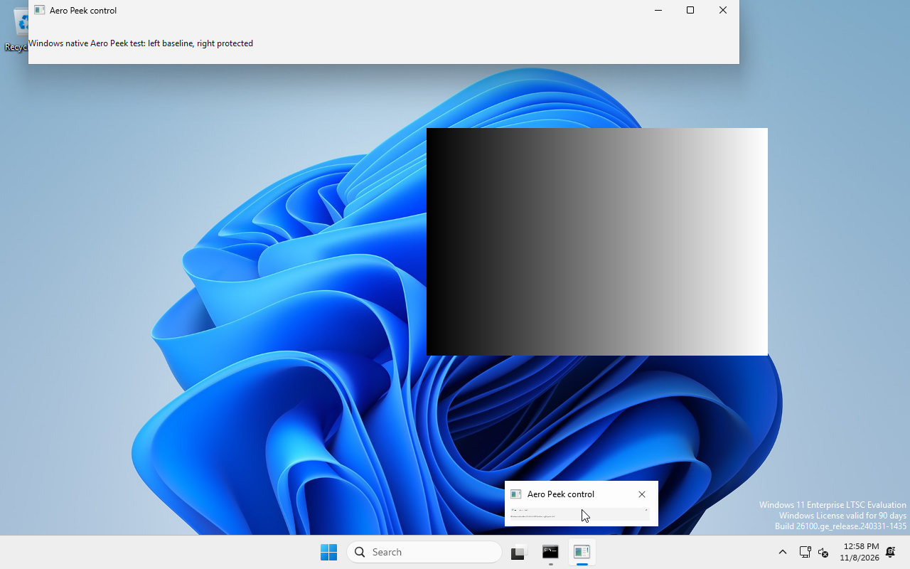
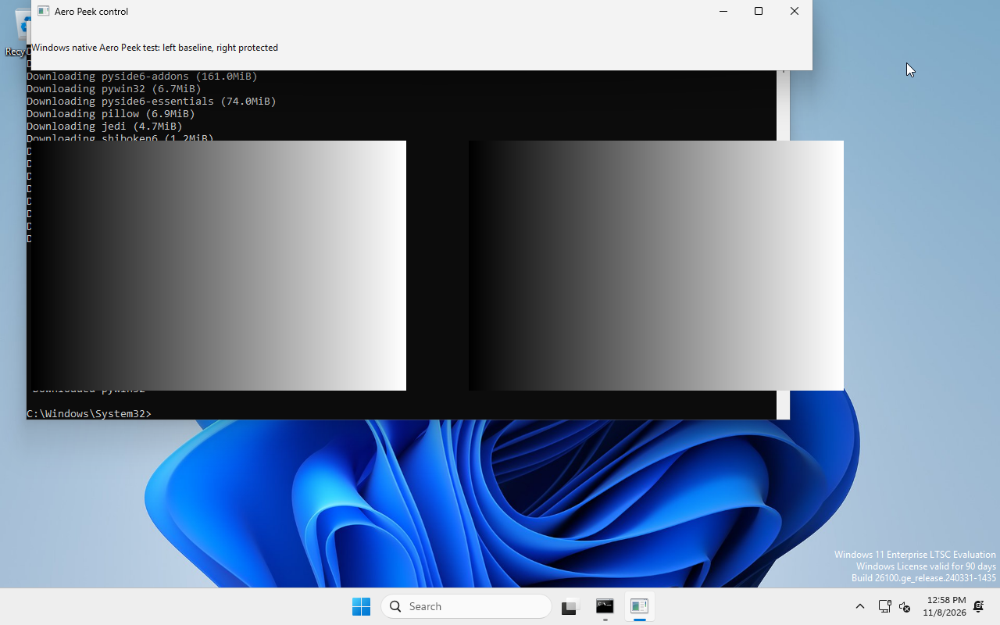

# Native Windows Aero Peek validation — 2026-11-08

The production Windows adapter and DisplayWindow from commit b051716 (fork version 0.3.4.post2+moretzai.20) were exercised in a persistent Windows 11 Enterprise LTSC 2024 Evaluation VM (build 26100), Python 3.14.10, PySide6 6.11.1, native Qt windows platform. Secure Boot and TPM 2.0 are enabled. Microsoft Basic Display Adapter provides a 1280x800 console at DPR 1.0; DWM composition is enabled.

## Result

**10/10 expectations passed**, including two consecutive genuine Explorer taskbar-thumbnail Peek trials. Two production DisplayWindows show identical gradients. The production adapter applies the real DWM exclusion to both HWNDs; the reference window then has both exclusions explicitly disabled. The protected HWND remains unchanged after arranging the windows side by side.

During each taskbar hover, the unprotected left window disappears (mean absolute RGB difference 99.7585), while the protected right window remains pixel-identical (difference 0). Leaving the thumbnail restores both windows (difference 0 for each). See [machine-readable results](taskbar-repeated-result.json).

Before Peek:


During Peek (left reference hidden, right output retained):



After Peek:



The full native Windows unittest run completed **39 tests: 38 passed, one Unix-specific signal test skipped**; see [log](windows-unittest.log). [Environment inspection](environment.json) records the activated TIMEBASED_EVAL edition.

## Reproduction

Read `/home/rolf/projects/windows-test-lab/README.md`. Start the existing guest with its controller, then run:

```sh
python3 /home/rolf/projects/windows-test-lab/test_taskbar_peek.py
```

The controller submits an interactive PowerShell job, loads the native probe from the LABFILES CD, finds the taskbar icon, moves the emulated USB tablet across the Explorer thumbnail, captures screenshots, and checks both the reference and protected output. Source copies are in [dev/windows](../../windows/); the host controller also requires the local lab's vm.py and Pillow. The VM controller, credentials and operating-system disk stay outside this repository.

## Review and limits

The observed production helper calls execute real DwmSetWindowAttribute calls, not mocked results. DwmGetWindowAttribute returns E_INVALIDARG for attributes 11/12 on this build; readback is therefore not used as evidence of successful configuration. Native setter results and visible A/B behavior establish the result.

An initial keyboard Win+comma trial succeeded, but later keyboard trials did not trigger Peek and correctly failed their changing-reference check. They are inconclusive input-trigger attempts, not accepted regression evidence. Real taskbar hover is the reusable test path.

This establishes taskbar Peek behavior on this Windows build and software compositor. It does not establish every Show Desktop shortcut variant, other Windows builds, physical GPU behavior, or optical SLM output. The isolated probe avoids blocking global Zenoh shutdown at process exit; this is test-harness cleanup, with no production behavior changed.
